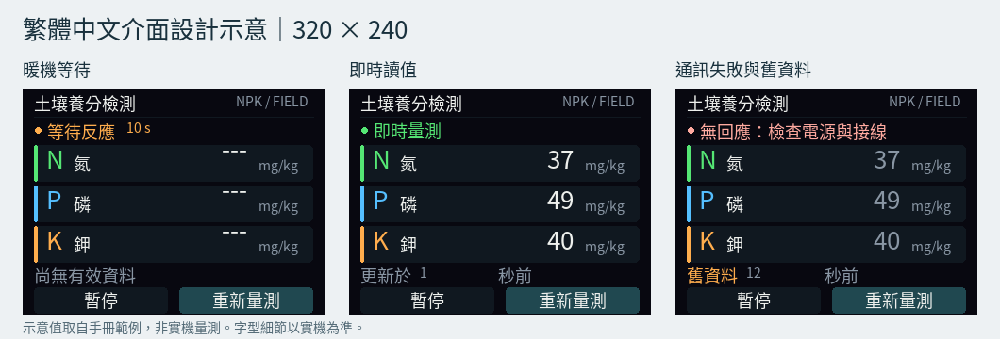

# CYD-NPK-portable

以 ESP32-2432S028（Cheap Yellow Display）、ILI9341 320×240 TFT、XPT2046 觸控及 MAX3485 RS485 模組製作的手持土壤 NPK 顯示器。採用 USB 5V 行動電源、繁體中文介面與 Modbus RTU，開機直接進入量測畫面。

已通過韌體編譯、桌面通訊測試，以及實機開機、NPK 封包收發與暫停／重新量測驗證。土壤量測準確度、電源餘裕與續航仍待驗證；完整結果與限制見 [驗證紀錄](docs/VALIDATION.md)。

## 文件導覽

- [硬體設計、供電評估與物料表](docs/DESIGN.md)
- [接線圖 SVG](docs/wiring.svg)／[接線圖 PNG](docs/wiring-preview.png)
- [感測器規格書](NPK-sensor-datasheet/土壤氮磷鉀感測器.pdf)
- [驗證紀錄與串口測試結果](docs/VALIDATION.md)
- [第三方素材與授權註記](THIRD_PARTY_NOTICES.md)

## 使用介面



- N／P／K 大字顯示，單位 mg/kg，使用感測器原始整數值，不自行換算成施肥建議。
- 每兩秒輪詢；開機與重新量測先等待十秒。等待時間為工程預設，並非穩定度判定。
- 暫停停止輪詢並保留畫面；繼續會清除舊值並重新等待十秒。
- 無回應、封包錯誤、感測器例外均顯示狀態；舊數值變灰並標明資料年齡，沒有有效資料時顯示 `---`。
- 開機直接進入 NPK 畫面，不強制觸控校正；等待十秒後開始讀值。未校正時停用觸控按鈕，底部顯示「長按BOOT兩秒校正觸控」，仍可使用 BOOT 或串口操作。
- BOOT 短按暫停／繼續；正常運行時長按兩秒啟動校正。依序點住三個十字約半秒後放開，校正成功後啟用觸控按鈕並將校正資料存入 NVS，下次開機直接沿用。不要按住 BOOT 再上電，以免進入下載模式。
- USB 串口 115200：`h` 暫停／繼續、`r` 重新量測、`c` 觸控校正。串口另輸出實際回覆封包與通訊錯誤。

## 接線重點

完整電源評估、接線及硬體驗收請看 [設計文件](docs/DESIGN.md)；方塊圖為 [wiring.svg](docs/wiring.svg)，另附 [PNG 預覽](docs/wiring-preview.png)。

| CYD／電源 | RS485 模組／感測器 |
|---|---|
| CN1 GPIO22（UART TX） | 模組 DI |
| P3 GPIO35（UART RX） | 模組 RO；建議外接 10kΩ 上拉至 3.3V |
| CN1 GPIO27（DIR） | 模組 DE 與 RE 短接；建議外接 10kΩ 下拉至 GND |
| CN1 3.3V | MAX3485 模組 VCC |
| 共地 | CYD GND、模組 GND、升壓器負端、感測器電源負 |
| USB 5V 分路 | CYD USB 入口及 5V→12V 升壓器 |
| 升壓器 12V | 感測器電源正 |
| 模組 A／B | 感測器 A／B |

DE 為高有效，板上 RE 指低有效的 `/RE`。兩腳接 GPIO27 後，LOW 為接收、HIGH 為傳送。GPIO35 僅輸入，用來接 RO，讓 GPIO27 可作方向控制。韌體已支援此接線，傳送完成後會自動切回接收。

感測器手冊為紅正、黑負、綠 A、黃 B；**以實物標籤為準**。表格不是 CN1 排針左右順序，請對照板上絲印。12V 只供感測器。

建議由同一 USB 5V 來源在進板前分路升壓至 12V，避免感測器負載經過 CYD 的 3.3V 穩壓器。CYD 3.3V 僅供 MAX3485；若要改由 3.3V 升壓供應感測器，須先驗證工作電流及穩壓器散熱餘裕，評估方式見設計文件。

## 編譯與燒錄

安裝 VS Code 的 PlatformIO IDE 擴充套件或 PlatformIO Core，取得專案後開啟資料夾，使用 `cyd-npk` 環境。採 Arduino framework on ESP32，無需另外啟用 ESP-IDF shell；依賴版本已固定。

```powershell
git clone https://github.com/victorsue0891/CYD-NPK-portable.git
cd CYD-NPK-portable
```

```powershell
# 若 pio 已在 PATH
pio run -e cyd-npk
pio device list
pio run -e cyd-npk -t upload --upload-port COM8
pio device monitor --port COM8 --baud 115200
```

`COM8` 僅為範例，請換成實際 CYD 埠。Windows 上若 `pio` 不在 PATH，可使用 VS Code 的 PlatformIO 終端機，或安裝於預設位置時執行：

```powershell
& "$env:USERPROFILE\.platformio\penv\Scripts\platformio.exe" run -e cyd-npk
```

燒錄前先斷開行動電源，避免電腦 USB 與行動電源兩個 5V 來源互相回灌。若只用電腦 USB 測試顯示功能，可暫時讓感測器斷電；畫面應呈現無回應。完整量測則需依設計文件供電。

韌體輸出：`.pio/build/cyd-npk/firmware.bin`，建議透過 PlatformIO upload 一併處理 bootloader 與分割表，勿將單一 app binary 當作完整映像。

## 主要設定

修改 [include/Config.h](include/Config.h)：感測器位址（預設 1）、UART 腳位、9600 baud、兩秒輪詢、700ms 逾時、十秒等待。顯示 SPI 為 40MHz，可在 `platformio.ini` 調低以測試訊號品質。

顯示使用 HSPI；XPT2046 使用 VSPI 與其板載專用接腳。未啟用 SD 卡，未連線 Wi-Fi／藍牙，未實作電量百分比、存檔或肥力分級。顯示器使用約 75KiB 的 8-bit sprite，無需 PSRAM。TFT_eSPI 編譯時的 `TOUCH_CS not defined` 提示來自未使用該庫的觸控功能；本專案由 XPT2046 庫獨立處理觸控。

## 測試與素材

通訊解析器與感測狀態機可在 Windows 電腦執行測試，使用同一份正式 C++ 程式碼，僅替換 UART／GPIO 與時間來源。開發工具使用 Python 3.11 以上及專案內虛擬環境；一般 PlatformIO 編譯不需安裝這些工具：

```powershell
python -m venv .venv
.\.venv\Scripts\python.exe -m pip install -r tools\requirements.txt
powershell -ExecutionPolicy Bypass -File tools\test.ps1
```

測試另驗證 MAX3485 開機接收、送出前啟用、保持 DE 到 TX 完成、送完切回接收，以及立即回覆不被清除。測試包含正確封包、手冊錯誤 CRC、每一位元翻轉、截斷、位址／功能碼／長度／量程錯誤、Modbus exception、本地 echo、分段接收、溢位、逾時恢復、暫停中回覆及 millis 溢位。硬體驗收另見設計文件，桌面測試無法驗證實際 UART 電氣、觸控方向或電源瞬變。

繁體字形來源為 Noto Sans CJK TC，依 [SIL OFL 1.1](assets/fonts/OFL.txt) 使用；已產生 `include/ChineseFont.h`，一般編譯不需下載完整字型或安裝 Python 工具。增加中文標籤後執行：

```powershell
.\.venv\Scripts\python.exe tools\generate_font.py
.\.venv\Scripts\python.exe tools\preview.py
```

硬體顯示設定參考 [CYD-Cyberpunk-Display](https://github.com/victorsue0891/CYD-Cyberpunk-Display)；本專案另外建立量測流程與介面。畫面預覽是設計示意，不是實機截圖。

## 專案結構

```text
CYD-NPK-portable/
├── platformio.ini          # 平台、套件版本及顯示 SPI 設定
├── include/                # 接腳、介面文字、字型及類別宣告
├── src/                    # 主畫面、感測器採集與觸控校正
├── lib/NpkProtocol/        # Modbus CRC 與 NPK 回覆解析
├── tests/                  # 桌面測試與硬體替身
├── tools/                  # 測試、字型產生與介面示意圖工具
├── docs/                   # 設計、接線圖、驗證紀錄與測試日誌
├── assets/fonts/           # 字型來源及 OFL 授權
└── NPK-sensor-datasheet/    # 感測器原始規格書
```

`.pio/`、`.venv/`、`build/`、本機 IDE 設定與完整字型下載檔不納入版本控制。中文子集標頭與接線／介面預覽已包含在 repository，可直接編譯及閱讀。
