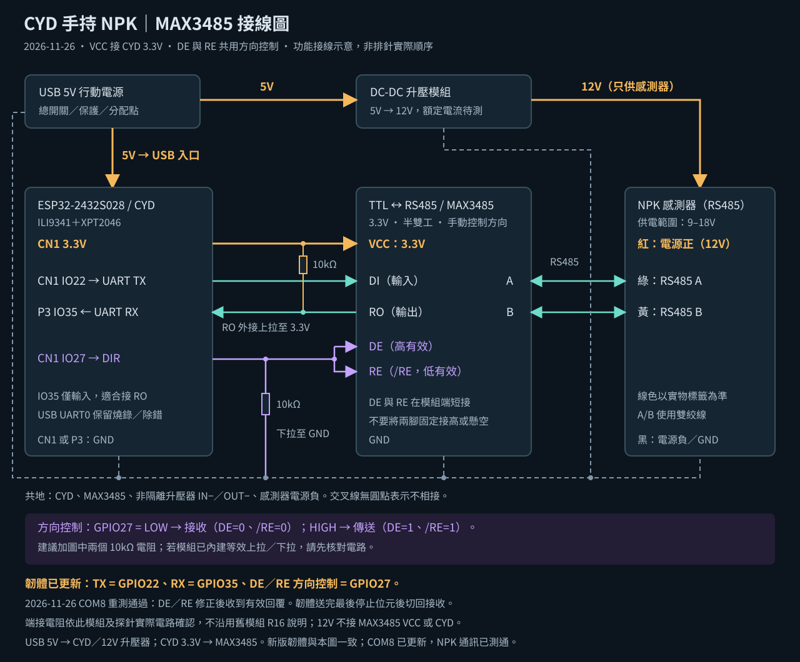

# 手持 NPK 顯示器設計 v0.2

更新日期：2026-11-26（Asia/Taipei）。已確認：USB 5V 行動電源、繁體中文介面、ILI9341 版 ESP32-2432S028；使用者更新模組為 MAX3485（DI／DE／RE／RO／VCC／A／B／GND），VCC 接 CYD 3.3V。此版為功能原型設計，尚未進行 PCB／機構出圖或硬體驗收。

## 1. 感測器依據與待確認項目

依 [土壤氮磷鉀感測器.pdf](../NPK-sensor-datasheet/土壤氮磷鉀感測器.pdf)：

| 項目 | 手冊內容／本案處理 |
|---|---|
| 型號 | 第 5 頁 GHHB-031-485；請確認實物是 RS485 版本 |
| 電源 | 第 6 頁 DC 9–18V，本案設定 12V |
| 量程 | 0–1999 mg/kg；超量程封包不更新顯示 |
| 反應時間 | ≤10s；本案首次／重新量測等待 10s 後開始讀取 |
| 通訊 | 第 10 頁 9600 baud、8N1、Modbus RTU，預設位址 0x01 |
| 暫存器 | 從 0x001E 一次讀三個 holding registers，功能碼 0x03 |
| 順序 | N、P、K，各 16-bit big-endian，1 count = 1 mg/kg |
| 接線 | 第 9 頁紅色電源正、黑色電源負、綠色 A、黃色 B；批次差異以標籤為準 |
| 缺少資料 | 工作電流、啟動電流、實際穩定時間與電源紋波容許值 |

手冊第 5–6 頁含「進氣口、電解液、氣體」等與土壤探針不一致的描述，且將解析度和精度都寫成 ±2%F.s。請向供應商確認適用條款；本案不據此宣稱量測精度或需要固定 48 小時暖機。顯示通訊成功也不代表養分測定已經過化學分析校正。

### 封包與手冊勘誤

請求（與手冊一致）：

```text
01 03 00 1E 00 03 65 CD
```

N=37、P=49、K=40 的完整正確回覆應為：

```text
01 03 06 00 25 00 31 00 28 3D 63
```

手冊第 11 頁把上述回覆 CRC 寫成 `41 07`；對前九個位元組重算 Modbus CRC16（初值 FFFF、多項式 A001、低位元組先送）結果為 `3D 63`。韌體不接受手冊中該錯誤範例。若實物持續回傳無效 CRC，先保存串口原始封包比對並詢問供應商。

本版只讀數值，不寫入或搜尋／修改感測器位址。手冊的自訂位址查詢／修改回覆也不完全符合一般 Modbus 形狀，應待實機確認後另行實作。韌體配置使用標準單播位址 1–247。

## 2. 電源架構



**更新方案：同一 USB 5V 來源分別供應 CYD 與 12V 升壓器，MAX3485 從 CYD 3.3V 取電。**

1. 5V → CYD 的 USB 供電入口。
2. CYD CN1 3.3V → MAX3485 模組 VCC。
3. 5V → DC-DC boost → 12V → NPK 感測器。

所有非隔離模組共地；感測器電流回到電源分配點，避免經過細長的 CYD 訊號地線。建議在電源分配入口設總開關與依實測負載選定的保護元件。本 MAX3485 模組按**非隔離**收發器處理。

行動電源可先以 5V／2A 等級作原型起點，但最終額定需求須由整機工作與啟動電流決定。確認行動電源不會因低負載自動關機。若採 USB-C 插座取電，使用含正確 CC 電阻的 5V 取電板／合規線材，不要假設裸接 VBUS 就能啟用 USB-C 電源。

### 原提案：CYD 3.3V → 12V

此方案尚待驗證，不應僅依升壓模組標示「2A」判定能帶動感測器；那可能是開關電流，而非 12V 輸出能力。

```text
Iin ≈ 12V × Isensor / (Vin × η)
```

以效率 85% 做試算（以下電流是假設，並非該感測器規格）：

| 12V 感測器電流 | 3.3V 輸入所需電流 | 5V 輸入所需電流 |
|---:|---:|---:|
| 30mA | 128mA | 85mA |
| 50mA | 214mA | 141mA |
| 100mA | 428mA | 282mA |

例如感測器若為 50mA，CYD 3.3V 端會增加約 214mA 負載；若由 5V 經線性穩壓供應，單是這部分就可能多耗散約 `(5−3.3)×0.214 = 0.36W`，還未計入原板負載。實際 CYD 板可能有不同穩壓器和供電分區，必須確認取電點及額定／散熱條件。

若仍採 3.3V 方案，需確認 boost 可在 3.3V 且帶負載啟動、CYD 該路穩壓器有足夠餘裕、啟動與最大負載不使 ESP32 brownout、連續運行溫升合理，以及 12V 輸出在負載／線長變化時仍穩定。這些資料尚未取得，所以本版圖面採 5V 分路作建議。

### DC-DC 選擇與配線

選擇明確支援 5V 輸入、12V 輸出、具所需連續電流與啟動能力的**升壓**模組。先量出感測器電流，再以足夠餘裕選型；避免僅用模組最大廣告數字估算。模組型號確定後才能定案電容、保護元件及外殼散熱。

調整輸出到 12.0V 並量測後，再接上感測器。依模組手冊配置去耦，實際使用長線時再量測輸出紋波與啟動壓降。將升壓器遠離 RS485 A/B 與 TFT／觸控排線，電源線短且有適當線徑。12V 不得接入 CYD 5V／3.3V／GPIO 或 RS485 模組 TTL VCC。

電腦 USB 和行動電源不要同時直接接到同一 5V 電源網。開發時先拔行動電源；若需要電腦通訊與行動電源同時工作，必須另設電源選擇／隔離，不能只靠 Y 型線。

## 3. 訊號接線與板載資源

本次以使用者確認的 **MAX3485** 及提供的模組照片為依據；[商品連結](https://www.ebay.com/itm/366803709714)已記錄，但本次工具無法讀取該頁內容，未據此宣稱板上電阻配置。原 TaiwanIOT 自動流向模組的 5V／TXD／RXD 接法不再適用。

[MAX3485 原廠資料表](https://www.analog.com/media/en/technical-documentation/data-sheets/MAX3483-MAX3491.pdf)規定 3.0–3.6V 工作電源，DI 為驅動器輸入、RO 為接收器輸出、DE 高有效、RE 低有效（常寫 `/RE`）。將 DE 與 RE 短接，由單一 GPIO 控制半雙工方向：LOW 接收，HIGH 傳送。此處不假設模組另有自動流向電路。

| 起點 | 終點 | 說明 |
|---|---|---|
| CYD CN1 3.3V | 模組 VCC | MAX3485 使用 3.3V；不接 5V 或 12V |
| CYD CN1 IO22 | 模組 DI | UART2 TX，保留原 TX 腳位 |
| 模組 RO | CYD P3 IO35 | UART2 RX；GPIO35 僅輸入且沒有內部上拉 |
| CYD CN1 IO27 | 模組 DE 與 RE 短接點 | 方向控制 DIR；LOW 接收／HIGH 傳送 |
| CYD GND | 共地點 | 模組 GND、非隔離 boost IN−／OUT−、感測器負極 |
| 模組 A | 感測器 A | 手冊為綠線 |
| 模組 B | 感測器 B | 手冊為黃線 |
| boost OUT+ | 感測器正極 | 手冊為紅線，12V |

建議 DIR 短接點外加 10kΩ 下拉至 GND，讓 MCU 重置時驅動器保持關閉；RO 外加 10kΩ 上拉至 3.3V，避免傳送時接收器關閉而讓 GPIO35 浮接。若模組已有等效電阻，先核對其阻值與接法；照片不足以確認。圖中 GPIO27、GPIO35 已與目前原始碼一致，CN1／P3 的 GPIO22 是同一條訊號，不可當兩支獨立 GPIO。

使用 A/B 雙絞線及共同參考地。端接與偏壓依此 MAX3485 模組、探針的實際電路及線長配置；不要沿用原模組「短接 R16 啟用 120Ω」說明。確認既有端接後再決定是否添加，避免重複並聯。不要帶電拆換探針。

CYD 腳位依使用者[既有專案](https://github.com/victorsue0891/CYD-Cyberpunk-Display/blob/master/platformio.ini)及 [CYD 接腳資料](https://github.com/witnessmenow/ESP32-Cheap-Yellow-Display/blob/main/PINS.md)核對，接線仍以實際板版次為準：

| 用途 | GPIO |
|---|---|
| TFT SPI（HSPI） | SCLK14、MOSI13、MISO12、CS15、DC2、背光21 |
| XPT2046 SPI（VSPI，獨立接腳） | CLK25、MOSI32、MISO39、CS33、IRQ36 |
| RS485 UART2（新接線） | TX22（CN1）、RX35（P3） |
| RS485 方向（新接線） | GPIO27（CN1）→ DE 與 RE 短接點 |
| BOOT 按鈕 | 0 |
| RGB LED | 4、16、17，本版關閉 |
| SD 卡 | 本版不啟用；未與觸控共用 VSPI 匯流排 |

不要使用 UART2 預設 GPIO16／17，這兩腳在 CYD 連接 RGB LED。USB UART0 GPIO1／3 保留給燒錄與串口。CN1 的 3.3V 腳用於 MAX3485 VCC。

## 4. 韌體與介面行為

**相容性狀態（2026-11-26）：MAX3485 新版已燒錄至 COM8 並通過寫入校驗。使用者修正 DE／RE 後，相同韌體在約 45 秒重測中取得 11 筆有效讀值（N/P/K 均為 0），無逾時或無效回覆，暫停／重新量測後也恢復正常。此為通訊驗證，不代表土壤養分準確度已驗收。** UART2 使用 TX22／RX35，GPIO27 控制短接的 DE／RE。初始化先將輸出暫存器設為 LOW，再啟用 GPIO27 輸出，讓預設狀態為接收；重置期間仍由外接下拉保持 DE 關閉。傳送前設 HIGH 並等待 10µs，送出完整請求後以 `uart.flush(true)` 等待 TX idle（含最後停止位元），再立即設 LOW 接收。這個 flush 不清除 RX 資料，以保留快速回覆；回覆 timeout 從切回接收後開始計算。2026-11-12 的舊 COM9 版本為 RX27／自動流向；2026-11-26 的 COM8 裝置已使用新版。

PlatformIO + Arduino ESP32 + TFT_eSPI + XPT2046。參考既有專案的 ILI9341_2 顯示驅動，SPI 改採 40MHz 起始設定；獨立指定 HSPI／VSPI，避免顯示與觸控被初始化到相同控制器。

資料流程：開機等待 → 每兩秒送一次請求 → 最多等待 700ms → 驗證位址、功能碼、長度、CRC、量程 → 更新三項數值。通訊錯誤不覆寫最後有效數據；資料變灰且顯示舊資料／秒數。輪詢會持續重試，復線後自動恢復。

接收使用固定 64-byte buffer，以 6ms 靜默結束資料段，容許分段到達與完全匹配的本地 request echo。700ms 是通訊回覆 timeout，與土壤量測反應十秒不同。UI 在等待 UART 回覆期間持續運作；傳送 8 bytes 的 TX flush 約佔 8.4ms。

「暫停」保留數字並停止新請求；已在途回覆會被忽略。它不關閉探針 12V，也不保證整機進入省電模式。「繼續／重新量測」清空顯示資料並等十秒。感測器沒有可用的「開始測量」命令，因此按鈕只是重新開始本機採集流程。

目前顯示字型已嵌入，不需 SPIFFS。開機一律進入 NPK 主畫面；即使尚無觸控校正資料，也不會被十字校正畫面阻擋。沒有有效校正時停用觸控點擊，底部提示長按 BOOT 兩秒啟動校正；BOOT 短按及串口控制仍可使用。已儲存的有效校正會直接載入，保留觸控功能。手動校正會在 NVS 儲存三點 affine transform，可處理座標方向與比例差異。沒有假資料 fallback，沒有從供電電壓猜測電量，沒有自動肥力高低門檻。

## 5. 原型物料與機構

| 項目 | 數量 | 選型條件 |
|---|---:|---|
| CYD ILI9341 版 | 1 | 核對板版次與 CN1 絲印 |
| RS485 型 NPK 探針 | 1 | 標籤與手冊一致 |
| MAX3485 TTL／RS485 模組 | 1 | 3.3V VCC、DI／RO 與 DE／RE 手動方向控制 |
| 10kΩ 電阻 | 2 | DIR 下拉、RO 上拉；先核對模組是否已有等效電阻 |
| DC-DC boost | 1 | 5V→12V 建議；輸出電流與散熱待測定 |
| USB 行動電源／線材 | 1 組 | 固定 5V，供電能力及自動關機需驗證 |
| 5V 分配板、總開關、保護元件 | 1 組 | 依負載電流選擇 |
| CN1 接線、A/B 雙絞線、4芯接頭 | 1 組 | 接頭防呆與線材拉力固定 |
| 外殼、絕緣支柱、螺絲 | 1 組 | 需量測實物與 DC-DC 尺寸後出圖 |

機構建議螢幕朝上橫向配置，探針線由頂端有拉力保護的四芯接頭引出，USB 與總開關置於側面。升壓器與 TTL／RS485 固定在絕緣支柱上，避開觸控背面與天線區；提供維修拆卸空間。探針 IP67 不代表 CYD 和整機防水，外殼規格需另訂。本版不提供未量測尺寸的可製造 STL／PCB。

## 6. 硬體驗收

1. **核對實物**：確認感測器是 RS485 版、線序、CYD ILI9341 版與 CN1／P3 腳位；先將 RX35／DIR27 新版韌體燒錄到裝置再測試新接線。
2. **量電源**：感測器未接時先調 12.0V；使用限流供電確認工作／啟動電流，再接行動電源測整機。記錄 DC-DC 型號、5V／3.3V／12V 負載電壓及溫升。
3. **單獨顯示**：先測開機、色彩、三點觸控校正、暫停／重新量測，重新啟動後確認校正有保留。
4. **正常讀取**：接妥探針並上電，十秒後應收到有效封包；用 USB-RS485 主機單獨比對數值。不要同時讓兩台 Modbus 主機驅動總線。
5. **斷線測試**：斷電後改變接線再上電，確認錯誤時沒有虛構零值／正常指示，復線後恢復；暫停時數字與資料年齡符合操作。
6. **實際土壤**：插入時避開石塊，不左右扭動；移動測點後按重新量測並觀察讀值穩定，記錄土壤條件。感測值可信度需另與參考檢測方法比較。
7. **連續運行**：至少進行一段有記錄的連續滿亮度測試，檢查重開機、通訊失敗率、電源關機、外殼熱點與觸控反應；量測總功率後才能估算續航。

以能量估算續航：`可用時間 ≈ 行動電源標稱 Wh × 實際可用效率 / 整機平均 W`。不能直接用電芯端標示 mAh 除以 5V 系統電流。

## 7. 下一版定案需要的資料

DC-DC 型號／規格、NPK 啟動及穩態電流、CYD 實物板版次／電源路徑，以及預計感測器線長。取得後可定案升壓器餘裕、保護與濾波零件、端接設定及機構尺寸。
